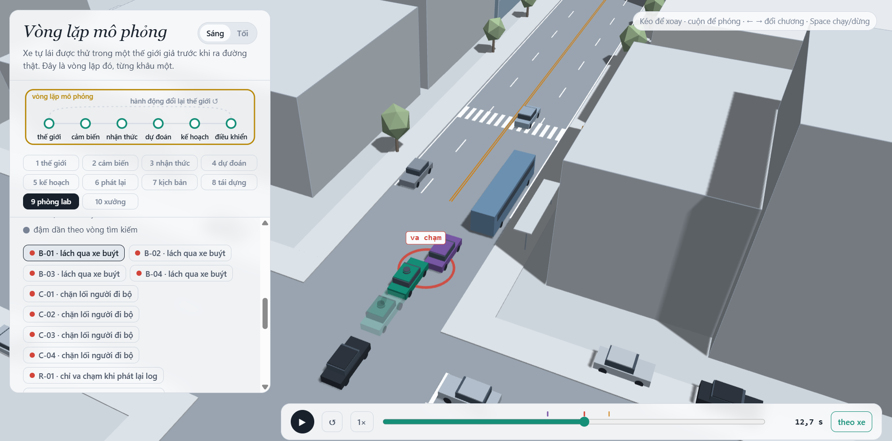
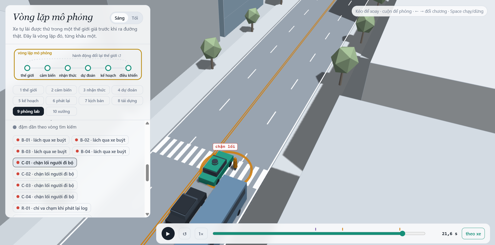
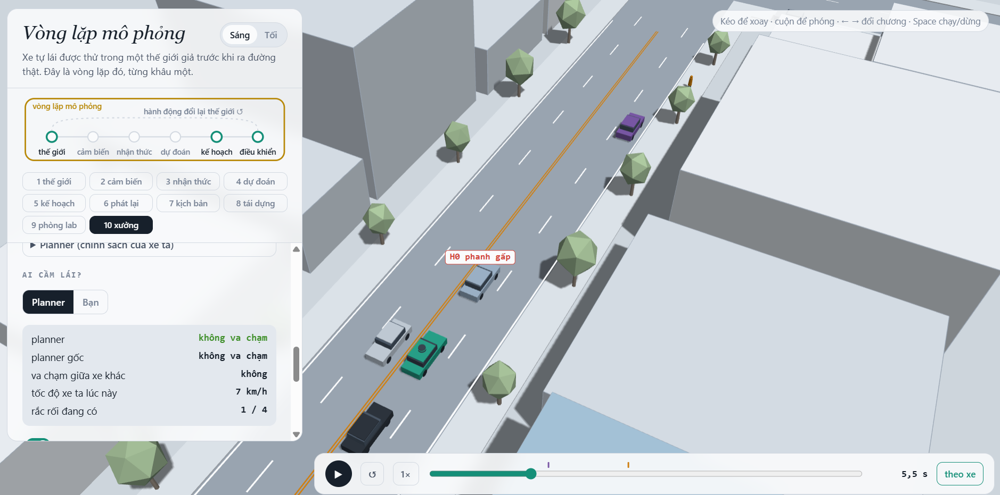

MSSV: 602954

# Lab 11 · Scenario Forge — báo cáo

MSSV gốc: `2A202602954`. Theo xác nhận được phép cắt MSSV, bài này dùng 6 chữ số cuối (`602954`) làm mã chạy mô phỏng vì `run_all.py` chỉ chấp nhận 6–12 chữ số. Dùng thống nhất mã này cho mọi lần chạy và khi đối chiếu kết quả; mã quyết định thị trấn và seed mô phỏng.

Mỗi câu: trả lời ngắn, **trích số từ `evidence/`** (ghi tên file và trường, ví dụ `mc.json: crashes = 4`). Grader chạy lại với MSSV của bạn; số không khớp `evidence/` thì mất điểm phần D (RUBRIC), và câu dựa trên số sai khó được điểm đầy đủ. Không cần văn hay: một bảng nhỏ và hai, ba câu giải thích là đủ.

Thị trấn của bạn (`meta.json: _run.town`): **C** (mã chạy `602954`).

## 1. Phát lại log có trung thực không? (bước A)

`replay.json`: `n = 400`, `dropped_human_crash_logs = 1`, `n_used = 399`. Trên 399 log giữ lại, `replay.crashes = 129` (`contact.rear = 113`, `contact.side = 16`), còn `reactive.crashes = 0`; `crash_in_both = 0`.

Log cố định quỹ đạo các xe khác theo người lái ban đầu. Khi planner phanh sớm hơn, xe bám đuôi trong log vẫn đi theo quỹ đạo cũ, không biết planner đã giảm tốc nên đâm vào phía sau. Đây là va chạm giả do cách phát lại; trong thế giới phản ứng, xe sau có thể phanh theo khoảng cách thực tế.

Ví dụ `replay_only[0].scenario = 0`, `contact = rear`, trong khi `min_ttc_reactive = 2.1344344097 s`. Quan sát R-01 ở khoảng 17,9 s: ego xanh ở cạnh xe buýt, xe bám đuôi phía sau áp sát đuôi ego; bảng kết quả ghi va chạm xe bám đuôi khi phát lại log. Kiểm tra bổ sung trên đúng lượt xuất ghi tiếp xúc ego–TG lúc 17,95 s (`viewer_checks.json`). Điều này phù hợp với cơ chế xe sau giữ quỹ đạo log, không phản ứng với việc planner giảm tốc. Ảnh R-01 chỉ dùng đối chiếu, không thuộc bộ ảnh nộp.

## 2. Kịch bản bất khả thi (bước B)

`is_feasible` loại nếu gia tốc ngang `(pi/cutDur)² × 3.5/2` vượt `mu × 9.81` (lốp không đủ bám khi chuyển làn), nếu `cutBrake > mu × 9.81` (phanh vượt giới hạn ma sát), nếu `pedV > 2.5 m/s` (ngoài phạm vi người đi bộ của bài), hoặc `cutV` không thuộc `(0, 22] m/s` (ngoài phạm vi tốc độ xe được mô hình hóa). Thời gian chuyển làn không dương cũng bị loại. Hai giới hạn tốc độ là giả định phạm vi của lab, không phải giới hạn sinh học hay vận tốc tuyệt đối ngoài đời.

`hunt.json: <mode>.infeasible`: `bus_bypass = 1`, `cut_in = 1`, `crosswalk_block = 11`, `rear_ended = 17`. Cuộc săn `rear_ended` sinh nhiều mẫu bất khả thi nhất. CEM thích các tương tác gấp vì làm TTC nhỏ, nhưng chuyển làn quá nhanh có thể đòi hỏi gia tốc ngang vượt lực bám; quét về vùng nguy hiểm cũng có thể kéo các tham số vượt giới hạn mô hình. Các mẫu đó không được chạy và không vào elite. Nếu tính chúng là thất bại, ta sẽ đưa các sự kiện ngoài miền khả thi vào tử số, làm xác suất bị thổi phồng.

## 3. Monte Carlo cho bạn biết gì (bước C1)

`mc.json`: `crashes = 4`, `n = 3000`, `p = 0.0013333333333333333`; Wilson 95% `[lo, hi] = [0.0005186172629797156, 0.0034235346800521676]`. Cả 4 thất bại đều thuộc `modes.bus_bypass`; `infeasible = 11`, không chạy và không tính chúng là thất bại.

Xấp xỉ sai số tương đối 20% cần `n ≈ 1.96²(1-p)/(0.2²p) ≈ 71.934` lượt; công thức sự kiện hiếm `n ≈ 96/p` cho khoảng **72.000 lượt**, gấp khoảng 24 lần ngân sách hiện tại. Đây là dự toán dựa trên p ước lượng, chưa phải bảo đảm độ chính xác.

`cut_in`, `crosswalk_block`, `rear_ended`, `other` đều chưa xuất hiện (`per_mode.<mode>.k = 0`). Với mỗi kiểu này, báo Wilson `[0, 0.0012788956648046956]` (`per_mode.<mode>.hi`), không kết luận xác suất thật bằng 0.

## 4. Importance sampling, ESS và độ suy biến (bước C3)

Các trường dưới đây lấy từ `estimate.json: seeds[seed].per.<mode>`; mỗi hàng có `n = 600`. Dấu “chưa thấy” thay cho ước lượng điểm bằng 0 để tránh hiểu sai; các hàng đó có `hits = 0`, `upper_zero_hits = 0.025`.

| Seed | Kiểu | p | hits | ess | top_share |
|---:|---|---:|---:|---:|---:|
| 0 | bus_bypass | 5.70867e-4 | 62 | 119.826 | 0.404024 |
| 0 | cut_in | chưa thấy; cận 0.025 | 0 | 124.146 | 0 |
| 0 | crosswalk_block | 4.196e-6 | 121 | 114.986 | 0.465368 |
| 0 | rear_ended | chưa thấy; cận 0.025 | 0 | 120.836 | 0 |
| 1 | bus_bypass | 4.19887e-4 | 67 | 113.985 | 0.427382 |
| 1 | cut_in | chưa thấy; cận 0.025 | 0 | 131.926 | 0 |
| 1 | crosswalk_block | 2.048807e-3 | 125 | 126.098 | 0.998089 |
| 1 | rear_ended | chưa thấy; cận 0.025 | 0 | 109.057 | 0 |
| 2 | bus_bypass | 5.88036e-4 | 80 | 113.030 | 0.594064 |
| 2 | cut_in | chưa thấy; cận 0.025 | 0 | 126.426 | 0 |
| 2 | crosswalk_block | 4.41e-7 | 119 | 119.317 | 0.175402 |
| 2 | rear_ended | chưa thấy; cận 0.025 | 0 | 119.042 | 0 |

`seeds[0..2].total` lần lượt xấp xỉ `5.75064e-4`, `2.46869e-3`, `5.88477e-4`. `bus_bypass` tương đối gần nhau, nhưng `crosswalk_block` chênh hàng nghìn lần giữa seed 1 và 2: ba seed không đồng thuận về kiểu này. Các tổng nằm trong khoảng Wilson tổng của MC, song điều đó không chứng minh IS chính xác; MC cũng có khoảng rộng và chưa thấy người đi bộ thất bại.

`top_share > 0.5` ở `seed 1/crosswalk_block` và `seed 2/bus_bypass`. Đặc biệt 0.998089 nghĩa là một mẫu mang khoảng 99,81% tổng `w*y`. Một kết quả như vậy gần như là trọng số của mẫu đó, rất nhạy với seed. `top_share` thấp cũng không chứng minh đã bao phủ mọi vùng thất bại.

`budget = 16800 = 4 × (8 × 300 + 3 × 600)`, gồm tìm kiếm và lấy mẫu IS (chưa gồm các bước khác). MC cần khoảng 72.000 lượt để hướng đến sai số tương đối ±20% tại p ước lượng, tức khoảng 4,29 lần ngân sách này. Tuy nhiên IS hiện chưa đạt ±20%: riêng `bus_bypass` seed 0 có `se = 0.000267124`, nên biên `1.96*se/p ≈ 91,7%`. Nếu MC có cùng p và se như hàng này thì cần xấp xỉ `p(1-p)/se² ≈ 8.000` lượt; vì vậy ngân sách này chưa chứng minh lợi thế chính xác so với MC. Ưu điểm rõ là tìm được nhiều ví dụ thất bại hiếm và khám phá kiểu MC bỏ sót.

`other` lấy từ `mc.json`, với `other.k = 0`, `other.n = 3000`, `other.hi = 0.0012788956648046956`; chưa quan sát được, không xem là không thể xảy ra. Không săn riêng vì `other` gom nhiều cơ chế không có một điểm nguy hiểm thống nhất. Tổng phải giữ phần này để không bỏ sót một phần tập thất bại. Khoảng `total.lo/hi` do pipeline tạo là xấp xỉ từ các mẫu đã thấy (có cộng cận `other` khi chưa thấy); không coi nó là chứng nhận an toàn cho các kiểu IS chưa có hit. Với mỗi kiểu chưa thấy, dùng `upper_zero_hits`, không dùng `3/ESS`.

## 5. Các kiểu thất bại (bước C2 + 3D)

| Cuộc săn | `hunt.json: <mode>.found` | Số bất khả thi bị bỏ |
|---|---|---:|
| `bus_bypass` | `bus_bypass: 135` | 1 |
| `cut_in` | `bus_bypass: 30` | 1 |
| `crosswalk_block` | `bus_bypass: 2`, `crosswalk_block: 66` | 11 |
| `rear_ended` | `bus_bypass: 14`, `crosswalk_block: 2` | 17 |

Chưa tìm được thất bại đúng nhãn `cut_in` và `rear_ended`; đây là giới hạn của cuộc tìm kiếm 8 vòng × 300 mẫu/kiểu, không chứng minh chúng không tồn tại. Nếu gộp một cuộc săn chung, CEM dễ tập trung vào `bus_bypass`, làm bỏ sót kiểu người đi bộ. Thực tế các cuộc săn `cut_in` và `rear_ended` cũng tìm ra chủ yếu `bus_bypass`.

B-01: ảnh cho thấy ego xanh tiếp xúc C2 tím cạnh xe buýt, có vòng đỏ và nhãn va chạm. Theo cơ chế mô phỏng, C2 chờ khe rồi chen qua xe buýt; ego nhận diện xe đang lấn sang quá muộn để giữ khoảng cách.

C-01: ảnh cho thấy thân ego chắn đường người đi bộ tại vạch, có vòng vàng và nhãn chặn lối; sự kiện bắt đầu lúc 21,3 s theo `viewer_checks.json`. Theo quy tắc mô phỏng, P1 chờ khe từ những xe nhìn thấy, sau đó bước ra khỏi vùng bị xe buýt che; ego dừng quá muộn nên chắn lối. Đây là `block`, không phải P1 bước vào thân xe.

## 6. Sửa planner (bước E + 3D)

`fix.json: chosen.policy = {"cutinLat": 3.3}`; các núm khác giữ mặc định. Planner coi xe đang lấn sang là xe phía trước sớm hơn (mặc định `cutinLat = 2.15`). Chọn hoàn toàn trên TRAIN: chỉ xét ứng viên có `progress >= 200.6836378187 m` (95% baseline), tối thiểu hóa `fail_hi`, hòa thì ưu tiên quãng đường cao hơn. `cutinLat = 3.0` và `3.3` cùng `fail_hi`; mức 3.3 đi xa hơn nên được chọn. Tổ hợp `cutinLat = 3.0, cautionV = 6.5` có cận thấp hơn nhưng chỉ đi 195.133 m nên không đủ điều kiện.

Các số sau lấy từ các hàng `baseline_train`, `chosen`, `baseline_test`, `chosen_test` trong `fix.json`:

| Tập / policy | fail | fail_hi_seen | fail_hi | progress (m) | harsh (khung hình/lượt) |
|---|---:|---:|---:|---:|---:|
| TRAIN gốc | 2.81915448e-4 | 5.03990538e-4 | 5.03990538e-4 | 211.245935 | 8.871094 |
| TRAIN chọn | 6.40572945e-7 | 1.02388773e-6 | 1.02388773e-6 | 210.088547 | 8.261719 |
| TEST gốc | 1.69837685e-3 | 3.22642360e-3 | 4.50531926e-3 | 213.015327 | 8.520333 |
| TEST chọn | 6.63836849e-7 | 1.30337831e-6 | 3.87801990e-2 | 212.809528 | 7.963333 |

TRAIN giảm quãng đường khoảng 0,548%; TEST giảm khoảng **0,0966%**, đều dưới 5%. `harsh` là số **khung hình** có gia tốc < -3 m/s² trung bình mỗi lượt, không phải số đợt phanh riêng biệt. Pipeline chỉ tính quãng đường tới thất bại đầu tiên, không ghi nhận đoạn chạy tiếp sau va chạm là tiến bộ.

Ước lượng điểm TEST của bản sửa thấp hơn baseline, nhưng không thể tuyên bố xác suất thật giảm đúng theo tỷ số hai ước lượng. `chosen_test.unseen = ["bus_bypass"]`, `chosen_test.bus_bypass.hits = 0`, nên cận trên của kiểu đó vẫn là `upper_zero_hits = 3/(0.2*400) = 0.0375`; `other_crashes.k = 0`, `n = 3000`, `hi = 0.0012788956648046956`. Cộng cả phần chưa quan sát làm `fail_hi` lớn hơn baseline dù `fail` nhỏ. `fail_hi_seen` chỉ nói về các kiểu có hit, không phải cận cho toàn policy. Không chọn lại policy theo TEST.

Ví dụ núm có thể phản tác dụng: `table[0]` giảm `cautionV` xuống 5.0, nhưng `crosswalk_block.p = 0.00014504520570912723`, cao hơn `baseline_train.crosswalk_block.p = 0.0000006405729448170154`, đồng thời quãng đường giảm mạnh. Cơ chế có thể là ego đi chậm làm khe thời gian đủ lớn để người đi bộ bước ra hoặc thay đổi thời điểm C2 chuyển làn. Người đi bộ và C2 phản ứng theo xe thực tế; giảm tốc độ không giữ nguyên quỹ đạo các tác nhân. Đây là diễn giải cơ chế cần kiểm chứng trên cảnh đối chứng, không khẳng định tỷ số xác suất thật từ riêng mẫu TRAIN vốn có thể suy biến trọng số.

Ảnh so sánh dùng chung [B-01, khoảng 12,7 s](evidence/shots/bus_bypass.png): xe chính xanh tiếp xúc C2, bóng mờ phía sau giữ khoảng cách. Kiểm tra bổ sung bằng Python trên đúng lượt xuất cho thấy policy gốc tiếp xúc C2 lúc 12,65 s, policy sửa không có sự kiện ego trong 24 s (`viewer_checks.json`, lượt B-01; file kiểm tra bổ sung, không phải bước pipeline chấm điểm). Với lượt ghim policy gốc này, **bóng mờ là policy sửa**. Các lượt C-01..C-04 vẫn bị chặn vạch với cả hai policy, nên bản sửa không giải quyết toàn bộ cơ chế người đi bộ.

## 7. Từ mô phỏng ra đường thật

Ba giả định cần ưu tiên kiểm định; đây là kế hoạch thu thập dữ liệu, chưa phải các nguồn dữ liệu đã được đo:

| Giả định trong `avsim/space.py`, thị trấn C | Dữ liệu thay thế và nơi thu thập | Hướng sai lệch dự kiến |
|---|---|---|
| `cutGap`: lognormal, trung vị 10 m | Video camera ven đường tại điểm xe buýt dừng; theo dõi quỹ đạo để đo khe trước/sau tại lúc tài xế bắt đầu chuyển làn | Nếu khe thực nhỏ hơn mô phỏng, mô phỏng có thể đánh giá thấp nguy cơ chen qua xe buýt; cần kiểm tra lại vì tương tác có thể phi tuyến |
| `pedLook`: xác suất ngó qua xe buýt 0,80 | Video quan sát người qua đường ở các điểm có xe buýt che; gán nhãn hành vi nhìn và thời điểm bước ra | Nếu người thật ít ngó hơn, mô phỏng có thể đánh giá thấp nguy cơ bất ngờ bước ra; mô hình nhìn cũng cần hiệu chuẩn theo hình học che khuất |
| `wet`: xác suất 0,20, hệ số ma sát cố định 0,5 khi ướt và 0,8 khi khô | Nhật ký thời tiết gắn với chuyến xe và thử phanh có kiểm soát trên từng mặt đường/lốp để ước lượng phân phối ma sát | Nếu đường thật thường ướt hơn hoặc ma sát thấp hơn, mô phỏng có thể đánh giá thấp nguy cơ do quãng phanh dài hơn |

Các hướng trên là giả thuyết cần đo bằng phân tích độ nhạy, không coi là quan hệ đơn điệu đã chứng minh.

## 8. Giới hạn

1. Thế giới chỉ có một con phố, một cấu trúc điểm dừng xe buýt và lượt mô phỏng dài 24 giây; xác suất không đại diện mọi loại đường, mọi hành trình hay rủi ro theo kilomet.
2. Xe khác chủ yếu dùng IDM và quy tắc chấp nhận khe/nhường đường cố định; chưa bao quát mất tập trung, khác biệt phản xạ hay phân phối hành vi tài xế ngoài đời.
3. Cảm biến gần như hoàn hảo ngoài che khuất do xe buýt; chưa mô hình hóa đầy đủ sai nhận diện, độ trễ, mưa làm giảm quan sát hay sai số vị trí.

Nếu có thêm một tuần, tôi sẽ đo độ nhạy theo khe chuyển làn, hành vi nhìn và ma sát; thêm sai số/độ trễ cảm biến; tăng ngân sách và số seed ở các kiểu có `top_share` lớn. Sau đó kiểm định trên cấu trúc đường mới và dữ liệu quỹ đạo độc lập.

## 9. Rắc rối của bạn (bước G + chương 10)

**Rắc rối:** xe phía trước L1 phanh gấp, mô phỏng phản ứng khi gặp vật cản hoặc hàng xe dừng đột ngột. Cảnh tự dựng đặt `decel = 7.5 m/s²`, `dur = 4.4 s`, `t0 = 0`, đường khô `mu = 0.8`, không kích hoạt theo khoảng cách (`trig = null`). Độ phanh nhỏ hơn `mu*g = 7.848 m/s²`, cảnh đạt kiểm tra vật lý. Phanh gấp có thể làm ego thiếu quãng phanh nếu giữ khoảng cách không đủ; đây là giả thuyết kiểm thử, không khẳng định planner chắc chắn thất bại.

**Phạm vi và căn cứ:** `hazard.json: space` quét đều `h0_decel = [5.0, 7.5]`, `h0_dur = [3.4, 5.4]`, `h0_t0 = [0.0, 2.0]`. Khoảng phanh bao phủ mức mạnh đến gần giới hạn đường khô; thời gian phanh lấy ±1 s quanh cảnh người làm dựng; thời điểm bắt đầu lấy hai giây đầu để kiểm tra độ nhạy. Đây là lựa chọn thiết kế thí nghiệm, không phải phân phối đo ngoài đời. Các mẫu phanh vượt ma sát, kể cả đường ướt, bị loại; kết quả có điều kiện trên phần khả thi được giữ lại trong khảo sát giao thông thị trấn C (`world` mặc định là `town`).

Không có dữ liệu tần suất thực. `exposure = 0.05` chỉ là mốc minh họa một lần mỗi 20 chuyến cho nhận định định tính “thỉnh thoảng”; không thể suy ra con số này từ lời nhận định đó. `hazard.json: why` nói rõ thiếu dữ liệu và phân tích độ nhạy với 0.01, 0.05, 0.10. Muốn hiệu chuẩn phải định nghĩa ngưỡng phanh gấp, thu thập dashcam/nhật ký gia tốc xe phía trước và đếm sự kiện trên tổng số chuyến. Không trình bày các tần suất giả định này như dữ liệu thực.

**Kết quả:** `mine.json: exact.planner = []`, khớp cảnh chương 10 không va chạm. Trong 1.500 mẫu đề xuất, `infeasible = 284`, `accepted = 0.8106666666666666` (81,07%, vượt yêu cầu 50%). Các số sau lấy từ `mine.json: baseline` và `chosen`; policy sửa lấy từ bước E (`cutinLat = 3.3`).

| Trường | Policy gốc | Policy sửa |
|---|---:|---:|
| n | 1216 | 1216 |
| crashes | 0 | 0 |
| avoidable | 0 | 0 |
| unavoidable | 0 | 0 |
| unattributed | 0 | 0 |
| low_speed | 0 | 0 |
| avoidable_foreknown | 0 | 0 |
| overlap_at_start | 0 | 0 |
| Wilson 95% `[lo, hi]` | [0, 0.0031492613467191143] | [0, 0.0031492613467191143] |

Không quan sát được lỗi planner trong phạm vi này; báo cận trên khoảng **0,315%**, không kết luận xác suất thật bằng 0. Dữ liệu phù hợp với nhận định planner đã xử lý tốt kiểu phanh gấp của L1 ở miền khảo sát này. Không có bằng chứng bản sửa tốt hơn policy gốc trong phép thử này, cũng không đủ để khái quát cho mọi tình huống phanh gấp.

**Độ nhạy tần suất mỗi chuyến:** tính bổ sung bằng `exposure × mine.json: baseline.hi` (hai policy có cùng cận). Không cần chạy lại mô phỏng vì exposure chỉ là hệ số quy đổi.

| Exposure giả định | Diễn giải minh họa | Cận trên quy đổi mỗi chuyến |
|---:|---|---:|
| 0.01 | 1 sự kiện / 100 chuyến | 3.14926135e-5 |
| 0.05 | 1 sự kiện / 20 chuyến | 1.57463067e-4 |
| 0.10 | 1 sự kiện / 10 chuyến | 3.14926135e-4 |

Ở mốc 0.05, `baseline.per_trip_hi = chosen.per_trip_hi = 0.00015746306733595573`. Các ước lượng điểm `per_trip` trong JSON bằng 0 do không có hit, không phải chứng minh rủi ro bằng 0. Để đặt cạnh `bus_bypass`, ba ước lượng ở `estimate.json: seeds[*].per.bus_bypass.p` là khoảng 4.20e-4–5.88e-4 cho một lượt giao thông thị trấn mô phỏng. Nếu coi một lượt đó là một đơn vị chuyến tham chiếu của lab, cận quy đổi ở mốc 0.05 thấp hơn các ước lượng điểm ấy; đây chỉ là so sánh mô hình có giả định đơn vị và exposure, không chứng minh phanh gấp ngoài đời an toàn hơn hay so hai đại lượng có cùng độ chắc chắn. Khi exposure thay đổi 10 lần, cận quy đổi cũng đổi 10 lần.

**Tự lái:** người làm từng thử và va chạm ở 3,3 s, nhưng lần đó dùng cấu hình cũ `decel = 9 m/s²`, vượt giới hạn ma sát. Hai ảnh cũ chỉ lưu trong `evidence/archive/`, không dùng làm bằng chứng cho cảnh 7.5 m/s² và không dùng để kết luận người lái kém hơn planner trong cùng cảnh hợp lệ. Chưa có kết quả tự lái trên cấu hình hợp lệ cuối cùng.

**Hướng sửa/kiểm thử tiếp:** không có thất bại quan sát được để biện minh cho việc đổi núm chỉ nhằm thắng cảnh này. Nếu mở rộng sang xe chen vào sát ego rồi phanh, có thể kiểm thử tăng khoảng cách thời gian `T` và ngưỡng nhận xe lấn làn `cutinLat`, nhưng phải đo lại quãng đường và các kiểu thất bại mới trên TEST. Nếu các núm không đủ, cần logic theo dõi giảm tốc xe trước và kiểm tra quãng phanh theo hệ số ma sát với biên trễ cảm biến. Đây là đề xuất cần thí nghiệm mới, chưa phải bản sửa đã được chứng minh.

Khi diễn giải kết quả: `avoidable` dùng phanh tối đa ngay khung hình đầu tiên vừa có rắc rối vừa nhìn thấy nó, không phải biết trước khi còn bị che; trường hợp biết từ lúc bắt đầu dù bị che là `avoidable_foreknown`. `unavoidable` nghĩa là phép thử phanh này vẫn va chạm, chưa chứng minh mọi cách đánh lái đều thất bại. `unattributed` là va chạm trước khi rắc rối bắt đầu, không quy cho cảnh mới. `low_speed` là thống kê bổ sung nằm trong các loại trên, không cộng thêm lần nữa.

Chuẩn `avoidable` lạc quan vì giả định nhận biết tức thì và phanh hết cỡ, nên có thể đếm nhiều hơn số va chạm planner thực tránh được; ngược lại chỉ thử phanh mà không thử đánh lái làm số đếm giảm so với tập mọi cách tránh. Cần trình bày cả hai hướng này cùng số liệu thực tế.
